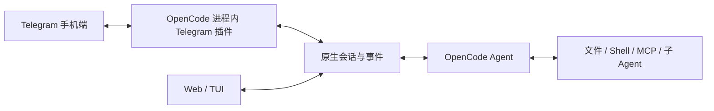

# Telegram 原生接入

Telegram 插件运行在 OpenCode 进程内。它使用 OpenCode 注入的 SDK 传输和原生事件操作真实会话，模型请求、工具循环、MCP、Agent、权限和压缩均由 OpenCode 处理。插件不保存第二套聊天上下文，也不另外配置 LLM API。Web/TUI 和 TG 可以查看同一个会话。



## Docker

在 BotFather 创建 Bot，将 token 和自己的数字 Telegram 用户 ID 填入 `.env`。用户 ID 是 `message.from.id`，不是用户名，也不是 Bot ID。模型和密钥使用现有 OpenCode 配置或 `opencode auth login`。

```bash
cp .env.example .env
# 编辑 .env：tg_token=...，tg_users=...，pwd=...
docker compose up -d --build
```

也可手动构建部署；本次代码需构建新镜像后才会出现在容器中：

```bash
docker build -t docker-opencode:telegram .
docker run -d --name opencode-tg \
  --env-file .env \
  -v opencode-data:/data \
  --restart unless-stopped \
  docker-opencode:telegram
```

仅使用 TG 时无需发布任何端口。示例 Compose 把 Web、终端和 SSH 绑定到宿主机回环地址；可通过已有 EasyTier 网络访问。镜像自带真正的 Node.js 22/npm 和 Python3 工具链。默认固定 OpenCode 1.18.3；升级后先验收插件，再使用 `docker build --build-arg OPENCODE_VERSION=版本号 ...` 构建。

容器自动将插件入口写到 `$data_dir/.config/opencode/plugins/docker-telegram.js`，将会话映射等放到 `$data_dir/.local/state/opencode/telegram/`。原有 `opencode.json(c)`、其他插件和认证保持可用。移除 `tg_token` 并重建容器会关闭镜像管理的 TG 入口。

## 直接安装：Node.js / Python / 非 Docker PaaS

需要已安装 OpenCode；兼容基线为 OpenCode 1.18.3 和官方 SDK 1.19.5。Node.js 安装脚本需要 Node.js 22；Python 脚本只用标准库，不需要系统 Node.js 或额外 Python 包。实际插件始终由 OpenCode 自带的 JS 运行时执行。

选择一个安装入口即可：

```bash
node scripts/install-telegram.mjs
```

```bash
python3 scripts/install-telegram.py
```

默认安装到 `$XDG_CONFIG_HOME/opencode` 或 `~/.config/opencode`；也尊重 `OPENCODE_CONFIG_DIR`。可用 `--config-dir /持久化目录/opencode` 指定安装位置，并在启动时设置相同的 `OPENCODE_CONFIG_DIR`。安装器保留原有配置及其他依赖，只增加官方 SDK 和插件文件。OpenCode 首次启动会安装 SDK 依赖。

在云平台的私密环境变量中设置：

```text
TELEGRAM_BOT_TOKEN=BotFather 给出的 token
TELEGRAM_USER_IDS=自己的数字用户 ID
TELEGRAM_DIRECTORY=/持久化目录/workspace
TELEGRAM_STATE_DIR=/持久化目录/telegram-state
```

直接启动 TUI 时，进入 `TELEGRAM_DIRECTORY` 运行 `opencode` 即可。启动 web/serve 时用本项目的启动脚本：

```bash
cd /持久化目录/workspace
oc_mode=serve bash /项目路径/scripts/start-opencode.sh
```

启动脚本需要 Bash 和 cURL。它在监听后读取工作区的工具注册表，触发 OpenCode 的延迟插件初始化，因此无需先打开网页才能接收 TG 消息。普通 `opencode serve` 的插件可能要等第一次相关请求才初始化。`oc_mode=web` 可同时开启网页。

Python PaaS 也需要允许执行 OpenCode 二进制、启动常驻进程并访问 Telegram；Python 运行时本身无法替代 OpenCode。若平台仅提供短时函数执行，需要改用支持常驻进程的部署方式。

## 操作

| 操作 | TG 入口 | OpenCode 行为 |
| --- | --- | --- |
| 编码任务 | 直接发文字 | 原生异步 prompt 和工具执行循环 |
| 会话 | `/new`、`/sessions`、`/use ID`、`/fork`、`/rename 标题` | 原生创建、切换、分叉和改名 |
| 状态与停止 | `/status`、`/history`、`/stop` | 原生状态、待办、消息和中止 |
| 模型 | `/model`、`/model 关键词`、`/model provider/model` | 已连接供应商的模型选择，`off` 恢复会话默认 |
| Agent | `/agent`、`/agent 名称` | 选择主 Agent，子 Agent 继续由 OpenCode 调用 |
| 推理档位 | `/variant 名称`、`/variant off` | 透传模型 variant，以模型配置为准 |
| 自定义命令 | `/commands`、`/cmd 名称 参数`、`/自定义命令` | OpenCode 已配置的命令 |
| Shell | `/shell 命令` | 原生会话 shell，无独立 shell 后端 |
| 上下文和变更 | `/compact`、`/diff`、`/undo`、`/redo` | 原生压缩、变更查看、撤回和恢复 |
| 输入文件 | 图片、文档和说明文字 | 保存到工作区 `.telegram/uploads/`，图片/PDF/文本附带原生 file part |
| 输出文件 | `/files [目录]`、`/get 相对路径` | 浏览和下载工作区文件；工具附件自动回传 |
| MCP | `/mcp`、`/mcp connect 名称`、`/mcp disconnect 名称` | 查看和连接已配置的 MCP |
| 权限 | 允许一次 / 总是允许 / 拒绝按钮 | 原生 permission.reply，沿用已有权限策略 |
| 追问 | 单选、多选按钮，或回复追问消息 | 原生 question.reply，多题逐题收集答案 |
| 恢复交互 | `/pending`、`/reply 答案`、`/reject` | 重建当前聊天待处理的权限和追问 |

多题也可一次提交：`/reply [["第一题答案"],["第二题选项A","第二题选项B"]]`。禁止自定义答案的题目只接受已有选项。

每个私聊或群组话题有自己的会话映射。只有 `tg_users` 中的用户可以发送任务和操作按钮；群组还须加入 `tg_chats`。普通群需 @Bot 或回复 Bot，显式允许的论坛话题可直接发送。一个会话同时只归一个聊天/话题操作；新建会话后，之前仍在运行的任务继续回传到原聊天。当前会话执行时，新的普通任务会提示使用 `/stop` 或 `/new`。

权限策略由 OpenCode 决定。如果现有配置把某工具设为 `allow`，该工具不会产生确认按钮；`ask` 才会弹出原生请求。模型 API、供应商登录和 MCP OAuth 继续使用 OpenCode 的原有配置流程。

## 持久化和边界

工作区、OpenCode 的配置/数据库/凭据、Telegram state 都应位于持久化卷。State 记录会话映射、模型/Agent 选择、更新游标、按钮及流式消息 ID。重启后会重建待确认请求，并恢复最近 100 条消息内尚未回传的当前任务结果。OpenCode 的历史消息仍可通过 `/history` 或 Web/TUI 查看。

更新游标在执行前持久化，防止重启后重复运行 Shell 等操作；如果进程恰好在游标提交后、任务交给 OpenCode 前崩溃，这条输入需要重新发送。消息发送与本地落盘也不具备跨服务事务，极小的崩溃窗口可能重复显示一条结果。插件不声称严格 exactly-once。

默认文件上限 20 MB；`tg_max_mb` 可设到 50，但 Telegram 官方 Bot API 的下载限制仍适用。音频、语音、视频会保存为工作区文件供工具处理，不包含额外的语音识别服务；能否处理图片/PDF取决于当前模型和 OpenCode。TG 无法呈现终端的完整交互屏幕、网页预览或 OAuth 浏览器界面，这些仍可用随镜像提供的 Web/TUI/SSH。

`tg_dir` 指定一个 OpenCode 工作区；切换不同项目的服务目录时，应同步调整 `tg_dir` 和持久化 state。不要让多个独立实例使用同一个 Bot token。插件在共享 state 目录内维护消费者锁；独立卷之间无法替你协调消费者。Bot 有旧 webhook 时会停止 TG 接入并记录原因，不会自动删除现有 webhook。

## 排查与验证

```bash
# Docker 的 OpenCode / 插件日志
docker exec opencode-tg tail -n 100 /tmp/opencode.err.log
docker exec opencode-tg sh -c 'tail -n 100 "$data_dir/.local/share/opencode/log/opencode.log"'

# 不连接真实 Telegram 的自动化验证
npm ci
npm test

# 使用本机真实 OpenCode 和本地 Telegram/模型模拟服务
node tests/native-smoke.mjs
```

`401` 通常表示 token 无效；`409` 表示另一个消费者仍在使用该 Bot。没有回应时，先确认数字用户 ID、群组 ID、工作目录以及启动脚本，随后检查 OpenCode 日志中 `telegram` 的初始化和错误记录。插件不把 token 写入日志或 state。

版本兼容代码集中在 `telegram/sdk.mjs`：目前 OpenCode 注入 v1 SDK，插件借用其传输配置构造官方 v2 SDK，以补齐 question/permission 接口；认证头和进程内 fetch 一并保留。升级 OpenCode 时先跑集成测试，确认这个边界仍兼容。
